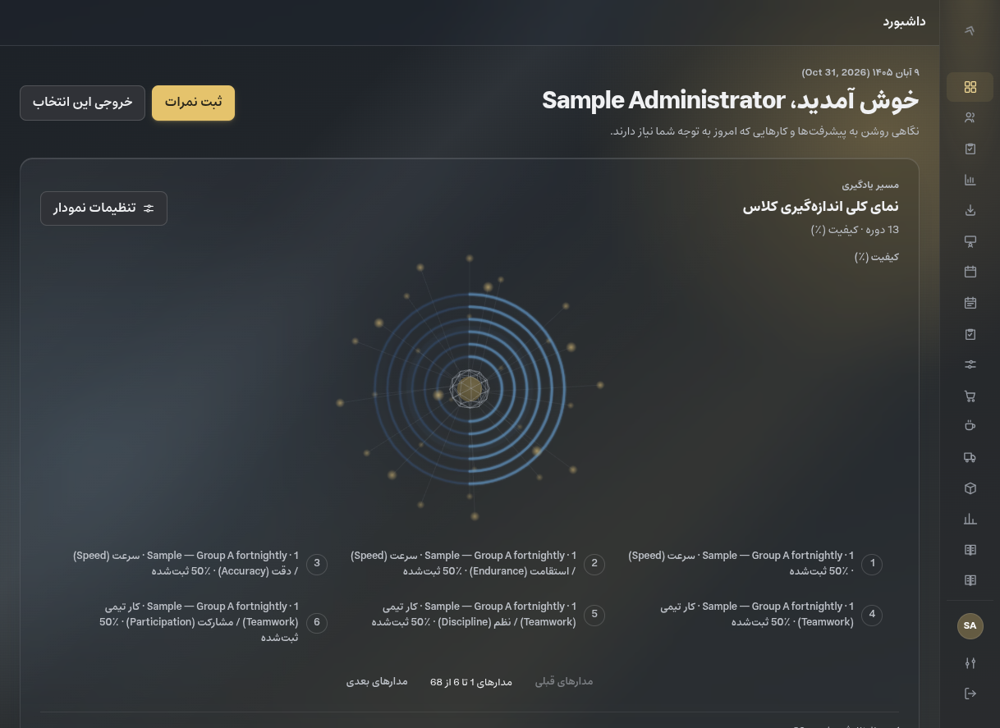
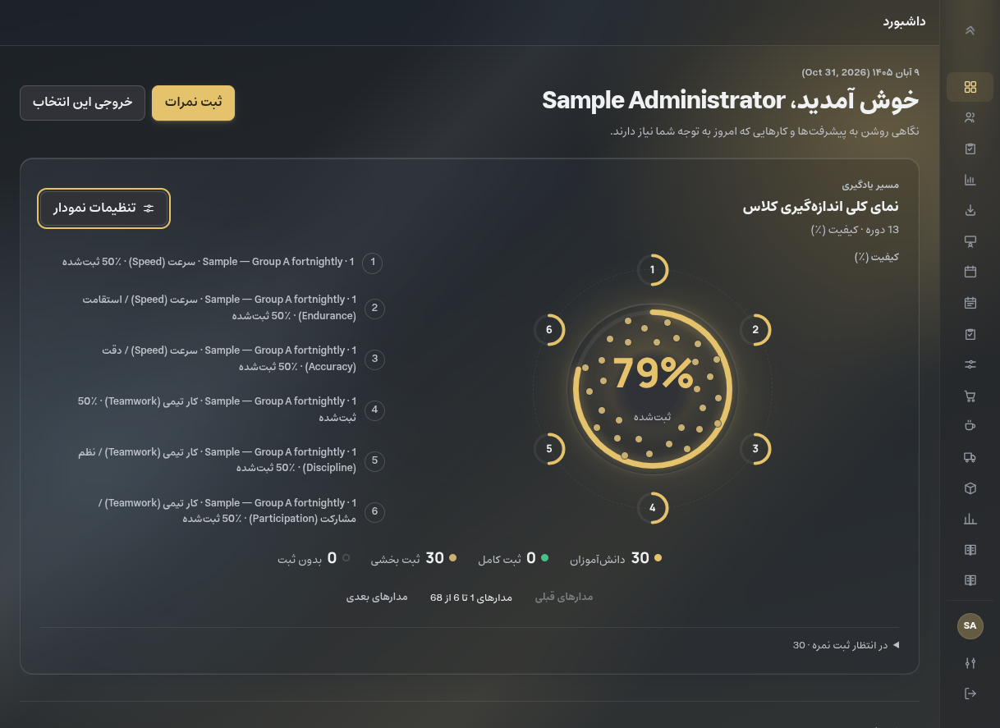
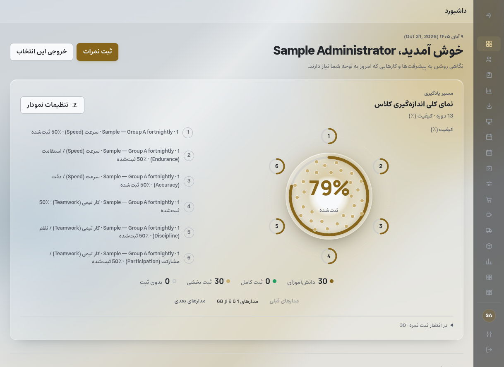
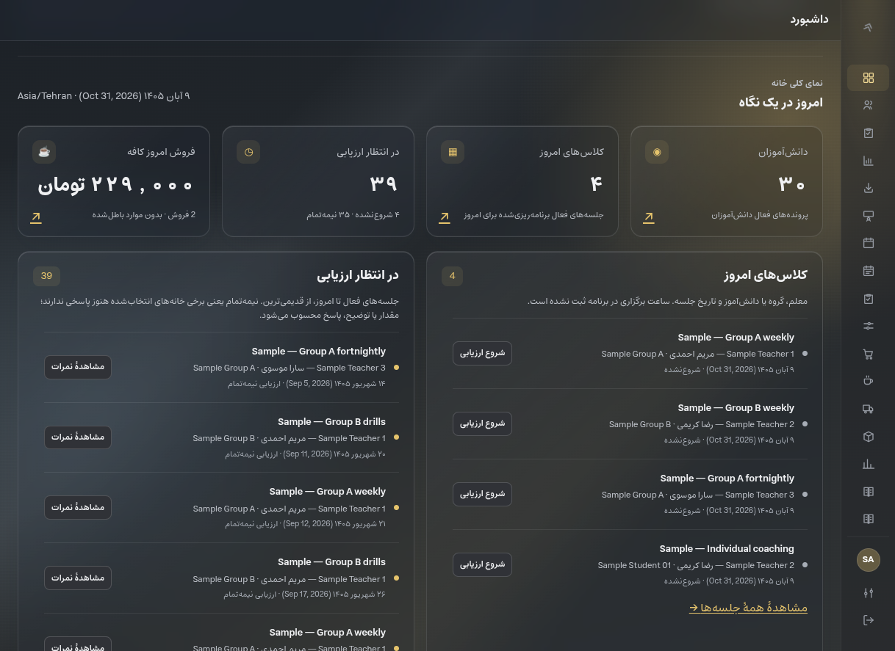
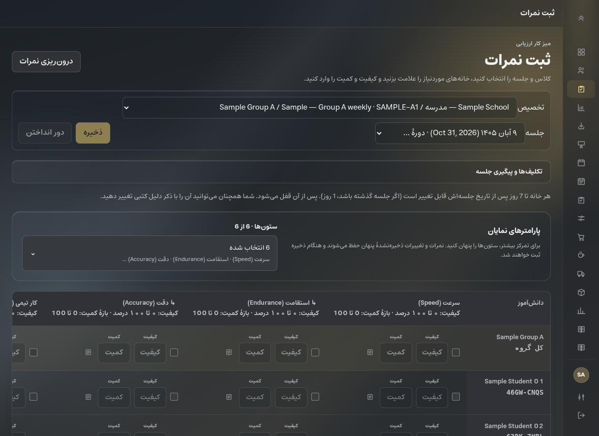
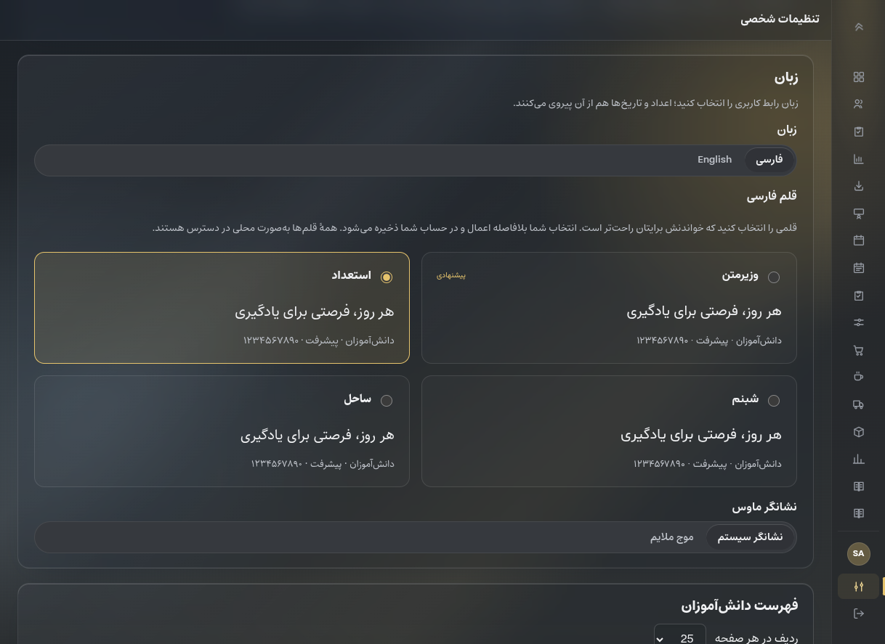
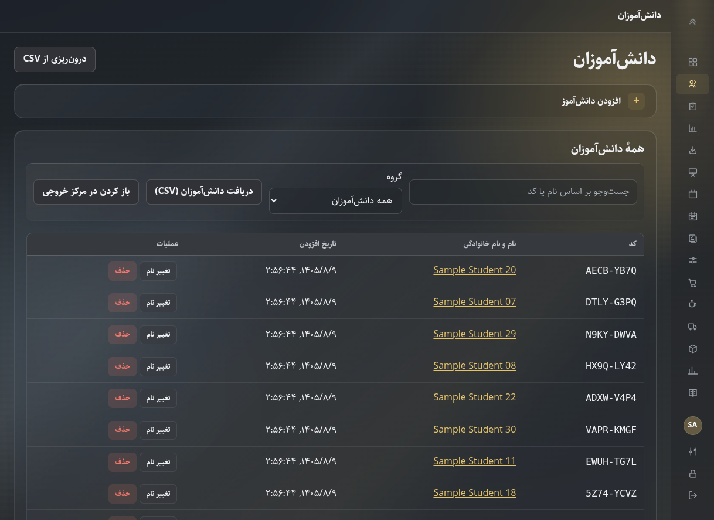
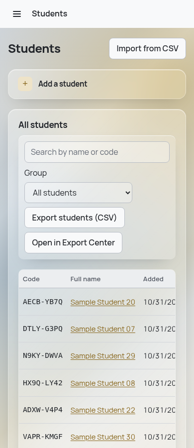
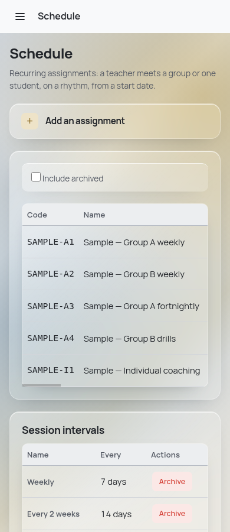
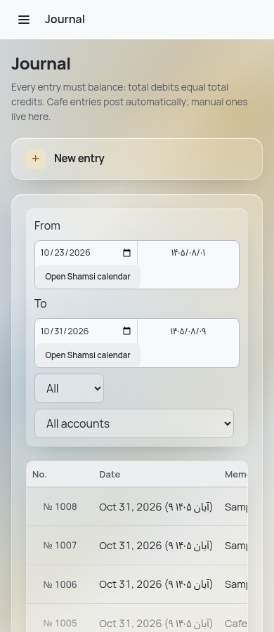

# Recovered application — completion record

Date: 2026-10-31. Repository: `https://github.com/hsjrua-git/sp-gemini-recovered`.
Branch: `recovery/glass-preview`. Foundation:
`9167d998c361c33d73149c95d68a6cd4a0fe64ce`.

The recovered edition has its own GitHub repository. The original
`sp-gemini-2` remote is retained locally as `recovery-source`.

The recovery implementation and verification are complete. This document is
versioned with the recovered application. Method: foundation/snapshot diff
review, unit/core/integration suites, PostgreSQL/API/UI comparisons, and live
Chromium checks against the built client. Historical audits retain their own
scope and dispositions.

## Completed interface

- Keep the bounded 350px 3D/2D chart above the practical Home Overview.
- **User feedback:** keep the new 2D labels stacked beside the chart, but put
  the 3D labels underneath the constellation. Implemented; measured live.
- **User feedback:** the first theme still looked too opaque. Reduced panel
  opacity, added clearer grey/gold background depth, softened edges and kept
  backdrop blur. Both light and dark versions were checked live.
- Dashboard contains today's classes, grading queue, student count, today's
  Cafe sales, quick actions, Cafe/accounting snapshots and a collapsible guide.
- Evaluate has hierarchical parameter visibility, preserved hidden drafts,
  dimension-labelled inputs, a sticky grid and session deep links.
- Preferences bundles Vazirmatn, Estedad, Shabnam and Sahel locally. Font,
  palette, theme and pointer choices persist per account.
- Students, Parameters, Users, Fields, Groups, Teachers, Schedule, Sessions,
  Cafe Products/Purchases and the accounting journal use compact creation
  disclosures. Native `<details>` keeps unfinished forms mounted when closed.
- Management row actions have clearer boundaries and destructive styling;
  accounting accounts/periods use the same action treatment. Sidebar icons
  are distinct, rail tooltips support keyboard focus, and Change Password is
  available in both rail modes.
- Shorter route transitions handle lazy-loaded replacement page roots and
  respect reduced motion. Date controls and the evaluation grid fit narrow
  layouts; wide tables retain their own horizontal scrolling.

## Recovery source inventory

Snapshot `2` was selected after comparing all three copies. Snapshot `1`
predates the useful interface improvements. Snapshot `3` has the same
application code as `2`, with broken root scaffolding. The two later problematic
GitHub commits are not ancestors of this recovery branch.

| Source area | Final disposition |
| --- | --- |
| `9167d99` application, auth, ledger and migrations | Foundation retained; all 37 SQL migrations are byte-identical |
| Snapshot-2 management pages | Integrated selectively with shared `CreateSection`, mounted form state, clearer actions and responsive controls |
| Snapshot-2 Home/setup ideas | Reworked into `HomeOverview` and a permission-aware `SetupGuide`; operational counts use the established session lifecycle |
| Snapshot-2 Dashboard/Evaluate layout | Adapted to the bounded chart, chart-options drawer, hierarchical visibility and preserved hidden drafts |
| Snapshot-2 glass, typography and pointer settings | Adapted into token-based palettes, locally licensed fonts and per-user preferences |
| Snapshot-2 navigation and transitions | Integrated distinct icons, themed tooltips and shorter transitions; lazy loading remains route-targeted |
| Snapshot-2 translations | Recovery additions use matching `fa/en/recovery.json` namespaces; existing translations remain available |
| Snapshot-2 Tailwind/Vite setup | Tailwind 4.3.3 installed through client PostCSS with `tw:` prefixes and no Preflight; established Vite configuration retained |
| Snapshot root startup scripts | Replaced with a root coordinator that builds before launching the real Express server and stops on build failure |
| Snapshot DB bootstrap, PGlite pool fallback and embedded recovery | Excluded; normal PostgreSQL configuration and explicit migrations remain authoritative |
| Snapshot automatic administrator provisioning and blanket route preloading | Excluded; existing account tooling and targeted lazy imports retained |
| Snapshot secrets, generated build output and metadata scaffolding | Kept out of the published application |

Preservation check: **1,525 snapshot files** and **3 `partly-schema/` files**
match the originals. `/home/hsjrua/Documents/sp-gemini-1` remains at `9167d99`
on `audit-fixes`, with its original configuration, backup and untracked
handoffs. Copied `check/`, `partly-schema/`, and private preview runtime are
retained locally. `audit/HANDOFF*.md` are preserved historical working files.

## Preview environment

- Independent folder: `/home/hsjrua/Documents/sp-gemini-recovered`.
- API and built client: `http://127.0.0.1:3390`.
- Isolated PostgreSQL 16: `student_panel_preview`, port `5488`,
  timezone `Asia/Tehran`. Private configuration and cluster are ignored by Git.
- Sample: 30 students, 4 groups, 3 teachers, 5 assignments, 71 sessions,
  13 answered periods, 573 evaluation cells, tasks and Cafe/accounting activity.
- Preview accounts: `sample-admin`, `sample-staff`, `sample-viewer`,
  `sample-accountant`, `sample-kiosk`; created through sample provisioning.
- Original project and recovery snapshots remain in the original folder.
  Copied evidence is retained separately from application source.

The Postgres MCP connection points at `sp_gemini_1_audit` on port `5432`.
Relevant schema was inspected there, then independently checked against the
actual preview using its private configuration. Live comparisons below used
only the isolated preview, with an explicit database-name/port assertion.

## Starting the recovered application

For a fresh checkout, follow the installation and configuration steps in
[`README.md`](../README.md). Install dependencies in `server/` and `client/`,
configure your own PostgreSQL database and `server/.env`, apply migrations, and
create an administrator through the existing CLI. Then, from the root:

```bash
npm start
```

The root launcher builds the client first, aborts on build failure, then starts
`server/src/index.js` with `server/.env`. This local preview uses port `3390`
and its separate PostgreSQL cluster on `5488`; both listeners must be running.
The private cluster and sample data are not part of a Git checkout. The sample
fixture can be created explicitly with `npm run seed-sample` against a
disposable development database.

## Verification

| Check | Result |
| --- | --- |
| Root `npm run lint` / final client lint | Passed |
| Root `npm test` | **501 passed**: 156 server unit, 58 core, 250 client, 37 agent; 6 integration cases gated here |
| Final client `npm test` | **32 files / 250 passed**, rerun after the last Layout/CSS fixes |
| Root / final client `npm run build` | Passed; bundled fonts included |
| `TEST_SERVER_URL=http://127.0.0.1:3390 npm run test-permissions` in `server/` | **6/6 passed**, zero skips, against isolated PostgreSQL |
| Server `npm run verify-pglite` | **37 migrations** and all shipped sanity checks passed |
| `git diff --check` | Passed |
| Persian/dark Chromium route sweep | **31 routes × 3 widths** (1280, 768, 390px); no boundary crashes, console errors or HTTP failures; two Evaluate overflow cases fixed and retested |
| English/light Chromium phone sweep | **31 routes at 390px**; no boundary crashes, console errors or HTTP failures; accounting tabs overflow fixed and retested |
| Final narrow-layout retests | Evaluate at 768/390px Persian and 390px English; accounting reports at 390px English: **zero document overflow** |
| Phone workflows | Drawer focus/Escape, collapsed-form draft retention, calendar selection/focus, SPA route visibility and Not Found rendering passed |
| Preservation | 37 unchanged migrations, 1,525 matching snapshot files, 3 matching partial-schema files |

The sweep used the authenticated sample administrator, awaited route content
and requests, and measured both closed and expanded creation forms. Phone
widths used Chromium device-metrics emulation. Desktop screenshots also used
the visible in-app browser. This was route/render verification, not an
exhaustive write-through test of every form.

### Confirmed by running

- Home Overview equals independent read-only SQL: **30 students, 4 today's
  classes, 39 grading sessions (4 not started, 35 partial)**. Uses database
  `CURRENT_DATE`; chart period/group selection is a separate scope.
- Cafe SQL equals report/API/UI: **2 sales, 229,000 Toman revenue, 84,000
  gross profit, −25,000 outstanding negative balances** on 2026-10-31.
- Posted journal lines equal the accounting snapshot: **229,000 income,
  188,000 expenses, 41,000 net profit**, fiscal start through today.
- Dashboard deep link selects the intended assignment and session in Evaluate.
- A draft quantity survives hiding and revealing its parameter. Invalid hidden
  input still blocks saving. Error navigation reveals the column and focuses
  quantity, including on repeated clicks. Test drafts were discarded.
- Escape closes the parameter picker and restores summary focus. Chart radio
  changes keep focus; Escape returns to the chart-options trigger.
- Both chart modes paginate six orbits. The 2D `.ring` has no rectangular
  shadow. Its numbered satellites match the side legend; the 3D legend sits
  below the canvas after the user's correction.
- Estedad persisted through API and reload; all bundled font families loaded.
  Persian/RTL, English/LTR, light and dark were checked.
- Viewer Dashboard has no financial panels or score-entry links. Viewer/staff,
  accountant and kiosk API reads return the expected 200/403 for Dashboard,
  Cafe and accounting permissions.
- Temporarily holding the Home request displayed loading without false zero
  figures. A browser-only simulated 503 displayed an error/retry action and
  hid stale metrics; restoring the real request and retrying recovered the
  data. The temporary request override was removed, then the page reloaded.
- Rail tooltip focus remained correct when accounting navigation scrolled into
  view. Escape dismissed the tooltip.

### Confirmed responsive regressions fixed during verification

Both findings below were **confirmed by running** the built application.

- **Moderate — Evaluate viewport overflow.** Long session labels forced a
  flex-item minimum width beyond 768px and 390px viewports. Fixed in
  `client/src/index.css` by allowing `.control-bar > .field` to shrink and
  constraining its select to the available width. Both Persian cases and the
  English phone case passed the final retest.
- **Minor — English financial-report tabs overflow.** Four tabs extended 14px
  beyond the 390px document viewport. Fixed in `client/src/index.css` by allowing
  `.tabs` to wrap. The final accounting-report retest had zero overflow.

### Retained evidence

The compact [verification summary](assets/recovery-preview/verification.json)
records test totals, sweep coverage, initial defects and passing retests.
Raw logs, route measurements and the temporary CDP harness are copied to the
ignored `.local/recovery-verification/` directory in this working copy; the
original `/tmp/opencode/recovery-*` artifacts are also retained. These include
`recovery-final-tests.log`, `recovery-permissions.log`,
`recovery-final-pglite.log`, `recovery-final-build.log`,
`recovery-route-sweep.json`, `recovery-evaluate-responsive.json`,
`recovery-english-phone.json` and `recovery-final-responsive.json`.

## Preview images

### 3D — labels underneath


### 2D — labels beside the chart



### Home Overview, Evaluate and Preferences




### Final management layouts


English/light, 390px Chromium viewport; tables scroll inside their containers:





## Verification limits and historical reconciliation

- Physical Android/Capacitor behavior was not tested; phone evidence is Chromium
  emulation. The recovered launcher was exercised on Linux, not Windows/macOS.
- Full real-PostgreSQL concurrency certification and fresh accounting/Cafe
  mutation-smoke runs were outside this recovery pass. Real permission tests
  and read-only financial comparisons passed; they do not replace race tests.
- No new Lighthouse/performance score or exhaustive accessibility certification
  is claimed.

`docs/audit-notes.md` is historical pre-remediation evidence; its disposition
history continues in `docs/audit-2026-10-28-sp-gemini-1-opencode.md` and
`FINDINGS.md`. The old Dashboard
option-change crash did not reproduce here. The tested date paths render
correctly, and restricted-role Dashboard behavior was checked as described
above. Other historical findings were not re-audited by this recovery; their
recorded dispositions are not changed. Kiosk confirmation/refund semantics,
partial-import behavior, deployment grants and physical-device checks remain
outside this recovery's verification scope.
